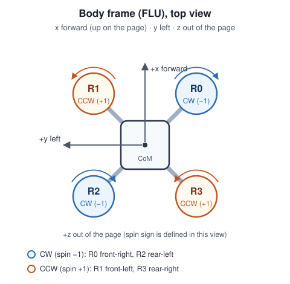

# Gate 0 — Interface Proposal

Draft v0.1 · 2026-10-25 · Albert

The point of G0 is simple: the three modules should use the same conventions, so we can
work in parallel without re-writing each other's code later. This is a proposal, not a
contract — reply with "OK" or the lines you want changed. We settle it at the 28 Oct
meeting.

Machine-readable version: `configs/base.yaml`. Shared types: `envs/interface.py`.
Checks: `pytest tests/test_interface.py`.

---

## 1. Frames, units, representations

| Quantity | Convention |
|---|---|
| World frame | **ENU** — x East, y North, z Up; origin at take-off point (same as PyBullet) |
| Body frame | **FLU** — x forward, y left, z up |
| Attitude | Unit quaternion `q_wb`, body → world, Hamilton, stored **`(x, y, z, w)`** |
| Position / velocity | World frame, m and m/s |
| Angular velocity | Body frame, rad/s |
| Position error | `p_target − p`, world frame |
| Units | SI only |

Quaternions are normalised and flipped so `w ≥ 0`: `q` and `−q` are the same rotation, and
without this the observation jumps for no physical reason.

Please confirm this matches what you plan to implement, Andy — especially ENU/FLU and
scalar-last quaternions, since PyBullet already uses them and there is no conversion.

---

## 2. Rotors and thrust



`L = arm_length_m` is the CoM-to-rotor distance; each rotor sits at `(±L/√2, ±L/√2)`.

| Index | Position (body, m) | Spin (from above, +z) | Label |
|---|---|---|---|
| 0 | `(+L/√2, −L/√2)` | CW (`−1`) | front-right |
| 1 | `(+L/√2, +L/√2)` | CCW (`+1`) | front-left |
| 2 | `(−L/√2, +L/√2)` | CW (`−1`) | rear-left |
| 3 | `(−L/√2, −L/√2)` | CCW (`+1`) | rear-right |

This order is used in every 4-vector: actions, applied commands, effectiveness, logs.

Actuator chain:

```
policy u ∈ [0,1]^4
   → fault module:   u_applied[i] = e_i(t) · u[i]      (e_i = 1 before failure, 0 after)
   → dynamics:       f_i = T_max · u_applied[i]        (N, along body +z)
```

Rotor torques (Andy's module; his G1 tests should confirm the signs):

```
τ_x = Σ y_i f_i
τ_y = −Σ x_i f_i
τ_z = −κ Σ spin_i f_i          (κ = rotor drag torque / thrust, N·m/N)
```

A CCW rotor (`+1`) gives a CW reaction torque on the body, hence the minus sign.

The fault acts on the normalised command **before** the thrust mapping, so the policy can
keep commanding a dead rotor — its applied thrust is still exactly zero. That is also what
G2 needs to verify.

**Default thrust curve is linear.** If you want motor lag or a quadratic curve, it stays
inside the dynamics module; the policy interface does not change.

---

## 3. Timing

| Item | Value |
|---|---|
| Physics rate | 240 Hz |
| Control / policy rate | 60 Hz (exactly 4 physics steps per action, zero-order hold) |
| Episode | 10 s = 600 control steps |
| Reward | Once per control step |
| Failure time | Seconds from episode start, rounded to the control grid (`t · 60`) |
| Fault takes effect | At that control step; the command entering that step is already masked |

60 Hz keeps the RL horizon manageable (600 steps per episode) while physics stays at 240 Hz.
If either rate changes, the obs/action timing changes too — so please flag it before changing.

---

## 4. Observation

One frame is 17 values:

| Index | Field | Dim | Frame / units | Scale |
|---|---|---|---|---|
| 0–2 | position error `p_target − p` | 3 | world, m | 1.0 m |
| 3–5 | linear velocity | 3 | world, m/s | 1.0 m/s |
| 6–9 | attitude quaternion `(x,y,z,w)` | 4 | body → world, `w ≥ 0` | 1.0 |
| 10–12 | angular velocity | 3 | body, rad/s | 10.0 rad/s |
| 13–16 | **previous** motor command `u_{t−1}` | 4 | normalised | 1.0 |

* Stack `H = 10` frames, oldest → newest. Total shape `(170,)`, `float32`.
* At time `t` the newest frame holds `u_{t−1}` — the command applied during the previous
  step, not the action about to be applied.
* On reset, the initial frame is repeated `H` times (no zero padding).
* Normalisation is fixed (`clip(raw / scale, −10, +10)`), no running mean/std. Fixed scales
  do not drift across curriculum stages; the constants are copied into the checkpoint.

**Hidden information.** The policy must not see the failed-rotor ID, failure time,
effectiveness, fault flag, scenario or its seed — directly or encoded. The observation
builder therefore takes only `(state, target, recent commands)`, never a `Scenario`.
`info` from `env.step()` may contain the scenario for logging; training must not feed it
to the policy.

The command history is there so the policy can infer "the rotor stopped responding" from
the relation between its commands and the vehicle's response. Without it, it cannot tell
"I commanded less" from "the rotor died".

**Defaults to check:** `H = 10`, world-frame velocity, target `(0, 0, 1) m`, fixed scales.

---

## 5. Action

| Item | Value |
|---|---|
| Shape | `(4,)`, `float32` |
| Bounds | `[0.0, 1.0]` |
| Meaning | Normalised motor command, not newtons |
| Order | 0 FR, 1 FL, 2 RL, 3 RR |

The environment clips and logs out-of-range values. The failed rotor stays commandable —
the fault module masks its applied value.

Normalised commands keep the policy independent of `T_max`, and leave the physical mapping
in one place (Andy's module).

---

## 6. Reward and termination

Per control step:

```
r_t =  w_alive
     − w_p  · ||p_target − p_t||²
     − w_v  · ||v_t||²
     − w_du · ||u_t − u_{t−1}||²
     − w_ω  · (ω_x² + ω_y²)
```

| Weight | Default | Why |
|---|---|---|
| `w_alive` | +1.0 | Otherwise crashing early is cheaper than surviving |
| `w_p` | 1.0 | Primary objective: stay near the hold point |
| `w_v` | 0.1 | Damping |
| `w_du` | 0.01 | Less motor chatter |
| `w_ω` | 0.001 | Roll/pitch rate only — **yaw is not penalised**, spinning is allowed |
| crash / out-of-bounds | −100 | Terminal |

No control-effort penalty: after failure, saturating the remaining rotors may be optimal.

| Termination | Signal |
|---|---|
| CoM `z < 0.05 m` (v1 crash rule) | `terminated`, −100 |
| Horizontal radius `> 5 m` or `z > 3 m` | `terminated`, −100 |
| 600 control steps | `truncated`, no terminal reward |
| Tilt limit | not used in v1 |

Crash by CoM height is a simplification. If PyBullet ground contact is cheap, we can use a
body-contact rule instead — it does not change the observation. Joe/Andy to decide.

Weights are defaults, tuning is expected. What matters for the interface is the *terms*, not
the exact weights.

---

## 7. Scenario and seeds

```python
Scenario(
    rotor_id=...,            # 0..3, or None for nominal
    failure_time_s=...,      # seconds, or None
    effectiveness=...,       # 0.0 = complete loss
    initial_position=(...),
    initial_velocity=(...),
    initial_quaternion=(...),
    seed=...,
)
```

Joe provides `sample_scenario(rng, mode)` with modes `nominal`, `fixed`, `random`.

| Use | Seeds |
|---|---|
| Training | 0 … 999 |
| Evaluation | 100000 … 100999 (never used for training) |
| Network init | SB3 `seed`, logged separately |

`env.reset(seed=s)` should fully determine the episode: initial perturbation and scenario.
No other RNG inside the environment. Failure times are quantised to the control grid.

---

## 8. Module interfaces

```python
# src/dynamics/ (Andy)
class QuadrotorDynamics:
    params: dict
    def reset(self, state: VehicleState) -> VehicleState: ...
    def step(self, state: VehicleState, u_applied: np.ndarray, dt: float) -> VehicleState: ...

# src/faults/ (Joe)
class FaultInjector:
    def reset(self, scenario: Scenario) -> None: ...
    def apply(self, u_cmd: np.ndarray, t_s: float) -> np.ndarray: ...
    def describe(self) -> dict: ...      # logs only, never observation

# envs/ (Gymnasium)
reset(seed=None, options=None) -> (obs, info)
step(u) -> (obs, reward, terminated, truncated, info)
observation_space: Box(170,), action_space: Box(4,)
```

Checkpoints (G3) carry the policy weights, the normalisation constants, the full config and
the seed. Evaluation runs with no learning.

---

## 9. Config and repo

* YAML, one file per run, no code. `configs/base.yaml` is the nominal config; curriculum
  stages get `curriculum_stage{1,2,3}.yaml` later.
* Repo layout is the one already created: `configs/`, `src/dynamics/`, `src/faults/`,
  `envs/`, `train/`, `eval/`, `tests/`, `results/`.
* One `main` branch; checkpoints and raw logs stay out of git.

---

## 10. Open questions

**Andy**
1. ENU/FLU and scalar-last quaternion — OK?
2. Rotor numbering/spin in the diagram — match your model?
3. Physics 240 Hz / control 60 Hz — OK?
4. Send mass, inertia, arm length, `T_max`, κ, motor lag. Using gym-pybullet-drones?

**Joe**
1. `Scenario` fields and `sample_scenario()` — OK?
2. Failure time quantised to the control grid — OK?
3. Crash: CoM height or PyBullet ground contact?

**All**
1. Target `(0,0,1) m`, 10 s episodes — OK?
2. Reward terms; weights can be tuned later.

---

Comments by **Tue 27 Oct 18:00**, freeze on **28 Oct**.
